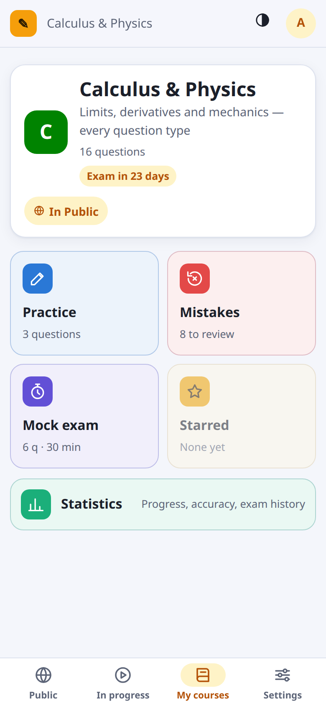
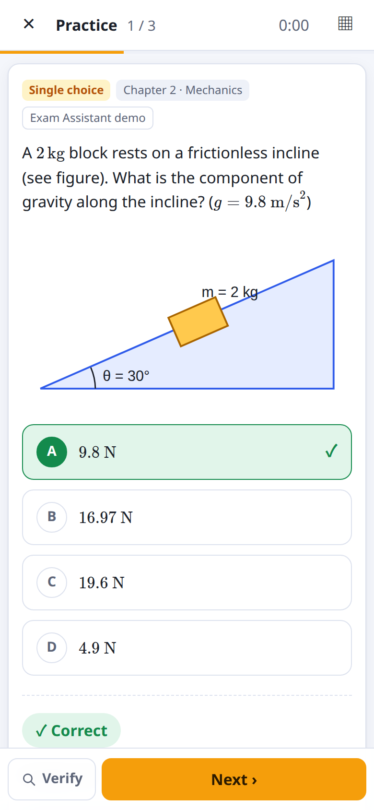
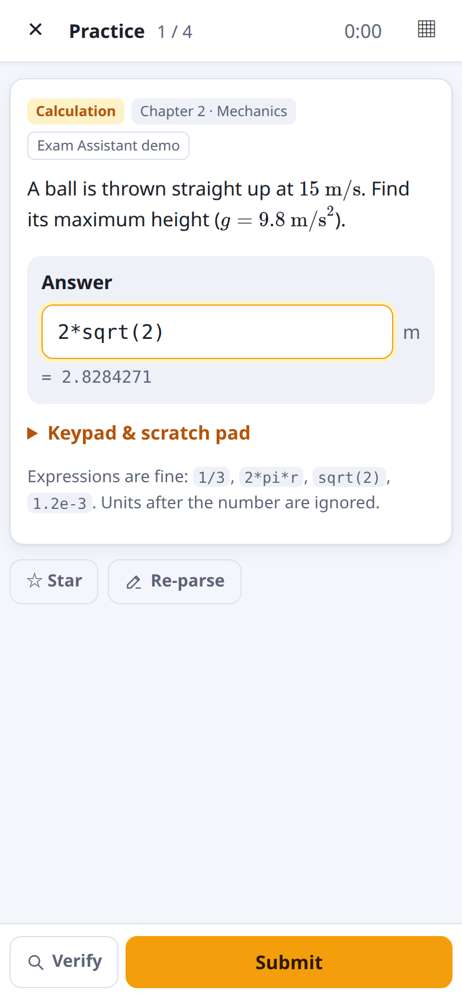
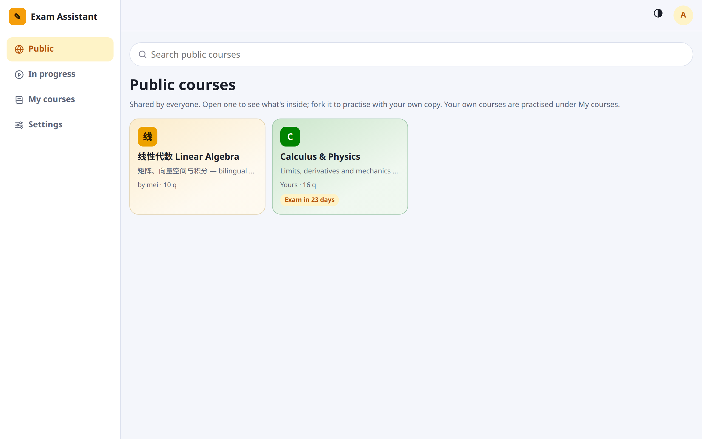
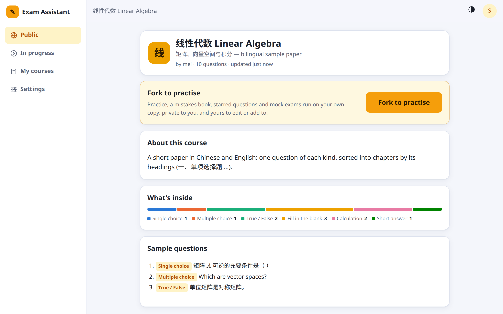
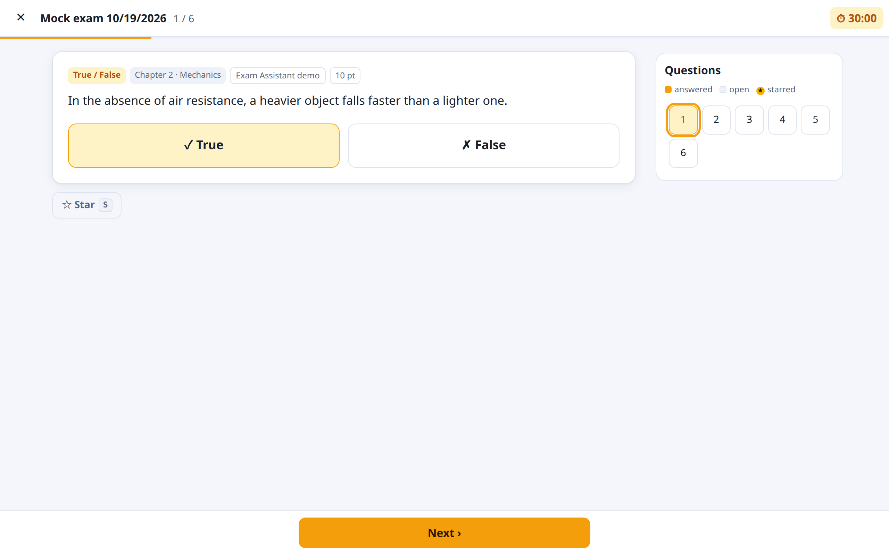
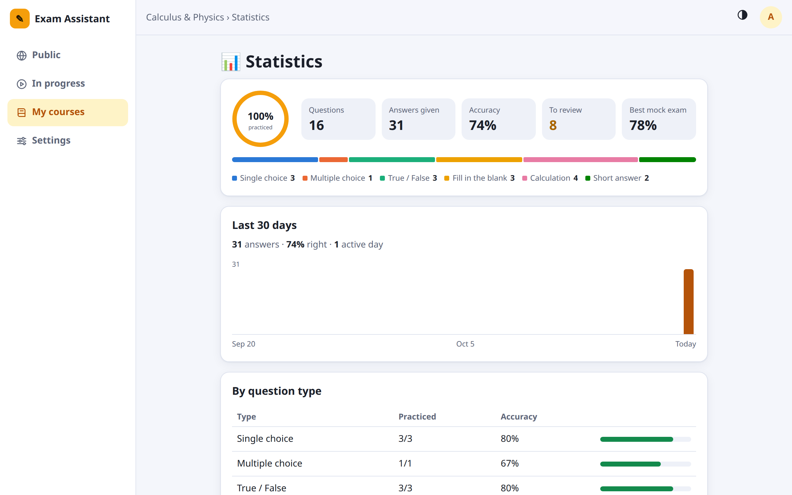
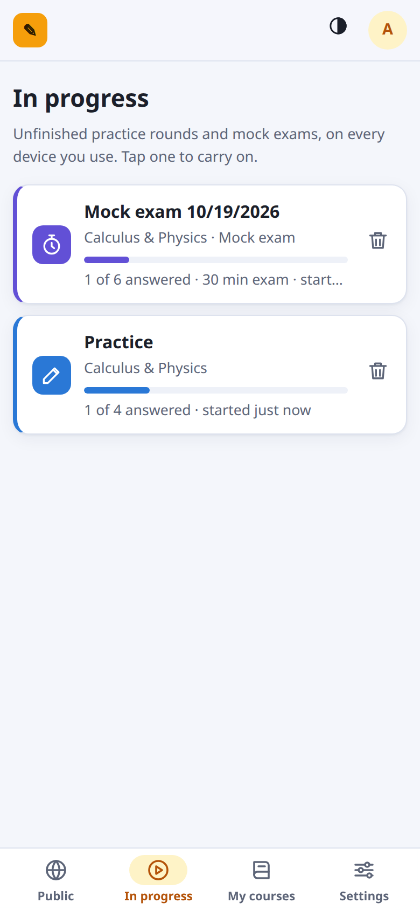
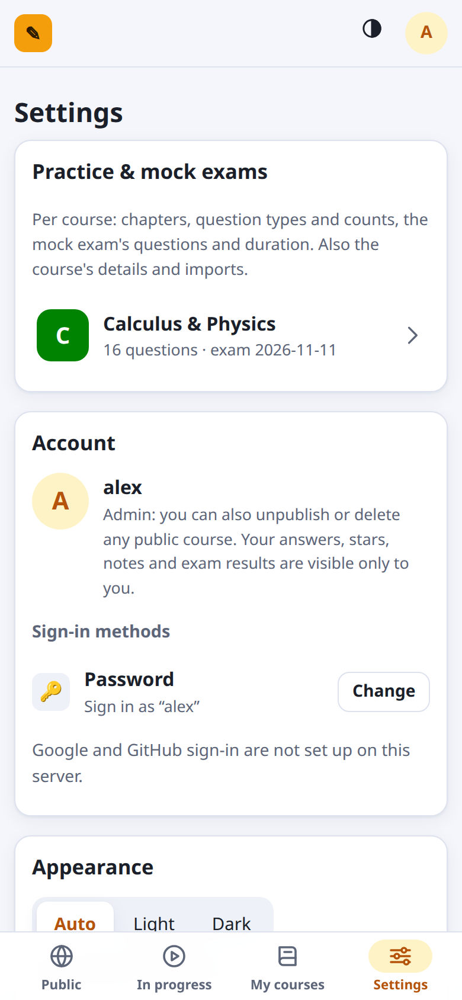
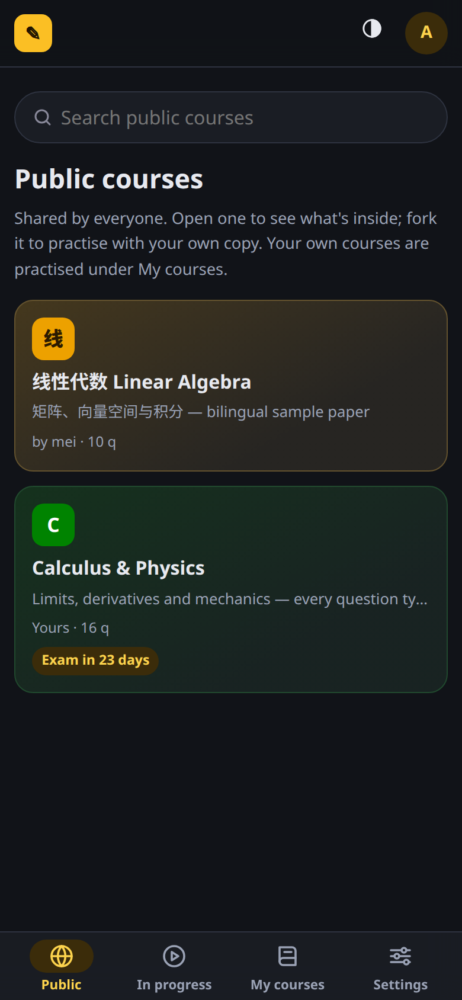

# Exam Assistant

**Practise past papers, review your mistakes and sit timed mock exams, on your phone or your computer.**

Exam Assistant is a small web app you run on your own machine. You load each course's questions (from pasted text,
Markdown notes or past papers that Claude finds for you) and practise them. Every question type gets an answer
screen that fits it, and wrong answers go into a mistakes book until you've got them right three times in a row. A
mock exam is timed and sets the paper the way the real one is set.

<p align="center">
  
  
  
</p>

## Quick start

You need [Node.js](https://nodejs.org) 20 or newer.

```bash
npm install
npm run demo     # optional: a sample course with every question type
npm start        # then open http://localhost:8710
```

The first account you create becomes the **admin**. When the app starts, it also prints its address on your local
network. Open that on your phone (same Wi-Fi), and add it to your home screen to use it like an app.

## Using it

Four tabs: along the bottom on a phone, down the left side on a laptop or desktop.

### Public: find a course

Every course that's been shared, with a search bar on top. Open a course to see what's inside: an *About* text, the
mix of question types, its chapters and past papers, and a few sample questions.

To practise someone else's course, tap **Fork to practise**. That makes your own private copy, which you can practise,
edit and add to.




### My courses: practise

Your own courses and your forks. Open one and pick a module:

| Module | What it does |
|---|---|
| **Practice** | Questions in random order, with the answer and explanation right after each one |
| **Mistakes** | Everything you got wrong. A question leaves after 3 right answers in a row, or when you remove it |
| **Mock exam** | Timed, with no feedback until you hand in. With past papers loaded, you choose a real paper and sit it exactly as it was set; otherwise the exam draws questions by your settings |
| **Starred** | Questions you've saved with ☆ |
| **Statistics** | How much you've practised, your accuracy by type and chapter, your daily activity, your mock exam scores and your most-missed questions |




### In progress: carry on where you left off

Every practice round and mock exam you haven't finished, from all your courses. Tap one to resume it, or delete it.
Rounds are saved on the server, so you can start on your computer and finish on your phone.

### Settings

- **Practice & mock exams**, per course: which chapters to use, which question types each module asks, how many
  questions a round has, and the mock exam's make-up (questions and points per type, duration). This is also where
  you edit a course's name, description and exam date, import more questions, export or print it, and delete it.
- **Account**: change your password, link Google or GitHub sign-in, sign out.
- **Appearance**: light, dark, or follow your device.

<p align="center">
  
  
  
</p>

## Answering questions

Each question type gets its own input:

| Type | How you answer |
|---|---|
| Single choice | Tap an option (or press A–D / 1–4); it's checked right away |
| Multiple choice | Tick options, then submit. Picking only correct ones, but not all of them, gets partial credit |
| True / False | Two big buttons (T / F) |
| Fill in the blank | Boxes inside the sentence; Enter jumps to the next blank. Full-width characters, letter case and equivalent numbers are accepted |
| Calculation | One box per part, with units. Expressions such as `1/3`, `2*sqrt(2)`, `pi/4` or `1.2e-3` work, with a live preview, a keypad and a scratch pad |
| Short answer | Write your answer, compare it with the reference (its key points are highlighted), then mark yourself: got it, partly or missed it |

Also everywhere:

- **Math, chemistry and media**: math and chemistry formulas render properly; images zoom when tapped; audio and
  video play.
- **Star and note**: star a question to save it, and keep notes on it.
- **Verify** (or G) searches Google for the question, so you can double-check an answer. It's hidden during mock exams.
- **Re-parse** (or P) shows a question's original source text when it was read wrongly from your notes. Fix the text,
  check the preview and save; your progress on the question is kept.
- **Keyboard and touch**: ←/→ to move, Enter to submit, S to star, M for the question list; swipe between questions
  on a touch screen.

## Getting questions in

The easiest way is to **ask Claude** (Claude Code, opened in this folder):

- "Find past papers for *Signals and Systems* and load them"
- "Load the questions in my vault folder *Courses/Calculus*"
- "Add these questions to *Economics*: …"

**In the app**: My courses → **Import questions**, or a course's Settings → Import. Paste text or drop `.md`, `.txt`
or `.json` files, preview them, then import.

**From the terminal**: `npm run import -- --course "Linear Algebra" notes/*.md`

The format is forgiving. A simple paper looks like this:

```markdown
# Chapter 1 · Matrices

1. Which matrix is invertible?
A. ...   B. ...   C. ...   D. ...
Answer: B
Explanation: its determinant is not zero

2. The identity matrix is symmetric.
答案：√

3. The trace of I₂ is ____ and its determinant is ____.
Answer: 2; 1
```

Numbered questions, `A. B. C. D.` options, `Answer:` / `答案：`, `Explanation:` / `解析：`, section headings like
`一、单项选择题`, Obsidian `![[image.png]]` embeds, `- [x]` checkboxes and `{{cloze}}` blanks all work. The full
reference is in [docs/FORMAT.md](docs/FORMAT.md).

## Accounts and sharing

- **Your progress is private.** Your answers, stars, notes, mock exam results, unfinished rounds and settings belong
  to your account only.
- **Courses are private until published.** A new course is visible only to you. Only the **admin** can publish a
  course to the Public tab or take one down.
- **Only the owner edits a course.** Everyone else forks it to get a copy of their own. A fork can bring your earlier
  progress with it.
- Anyone who can reach the app can create an account. Sign in with a username and password, or with Google or GitHub
  once those are set up (below).

<details>
<summary><b>Setting up Google / GitHub sign-in</b></summary>

The buttons appear once a provider has a client id and secret. Put them in `data/oauth.json` (read on every sign-in,
no restart needed), or in the environment variables `GOOGLE_CLIENT_ID`, `GOOGLE_CLIENT_SECRET`, `GITHUB_CLIENT_ID`,
`GITHUB_CLIENT_SECRET`, `EXAM_PUBLIC_URL`, `GOOGLE_PUBLIC_URL` and `GITHUB_PUBLIC_URL`:

```json
{
  "publicUrl": "http://192.168.1.7:8710",
  "github": { "clientId": "…", "clientSecret": "…" },
  "google": { "clientId": "…", "clientSecret": "…", "publicUrl": "http://localhost:8710" }
}
```

Register `<publicUrl>/api/auth/oauth/<google|github>/callback` as the callback with the provider. Sign-in always
finishes at that address, so open the app there.

- **GitHub**: Settings → Developer settings → OAuth Apps → New OAuth App. Use `<publicUrl>` as the homepage URL and
  the callback above. A local network address like `http://192.168.1.7:8710` works.
- **Google**: Google Cloud console → APIs & Services → Credentials → Create OAuth client ID (Web application), with
  the callback as an authorized redirect URI. Google accepts only `localhost` or a real domain, not a local network
  IP. With a `localhost` address, the Google button shows only in a browser on the server machine; on a phone, use
  GitHub or your password.

Accounts are matched by the provider's user id, never by email. A Google or GitHub account joins an existing account
only when you link it from Settings → Account while signed in. If a first sign-in made a separate account by mistake,
`node scripts/merge-account.mjs --from <stray> --into <yours>` folds it into yours (back up first).

</details>

## Your data

Everything lives in one file, `data/exam.db`. Images and audio from your notes are copied to `data/media/`. It's saved
as you go, so restarting the app loses nothing.

- `npm run backup` writes a snapshot to `data/backups/` and keeps the newest 30. It's safe while the app is running.
- A course's Settings → Export saves its questions as JSON.

## For developers

```bash
npm test                        # unit + API tests
npm run test:e2e                # every question type in a real browser, at phone and desktop sizes
node scripts/screenshots.mjs    # re-take the screenshots in this README (sample data only)
```

No framework and no build step: a Node server (`server.mjs`), SQLite through the built-in `node:sqlite`, and plain
ES modules in `public/js/`. `CLAUDE.md` maps the code.
